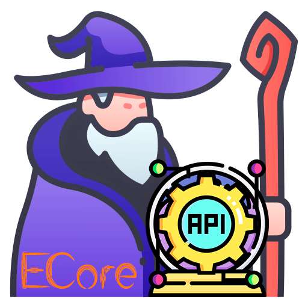

<p align="center">
  
</p>

<h1 align="center">EverNifeCore</h1>

<p align="center">
  <strong>One codebase. Minecraft and Hytale.</strong><br>
  The framework that lets you write a plugin once and ship it from Minecraft 1.7.10 to the newest releases, and to Hytale.
</p>

<p align="center">
  <a href="https://github.com/EverNife/EverNifeCore/releases"></a>
  <a href="https://github.com/EverNife/EverNifeCore/actions/workflows/build.yml"></a>
  
  
  
  <br>
  <a href="https://discord.petrus.dev/"></a>
  <a href="https://www.spigotmc.org/resources/97739/"></a>
</p>

<p align="center">
  <a href="https://github.com/EverNife/EverNifeCore/wiki"><b>📖 Wiki</b></a> &nbsp;•&nbsp;
  <a href="https://github.com/EverNife/EverNifeCore/wiki/Quick-Start"><b>🚀 Quick Start</b></a> &nbsp;•&nbsp;
  <a href="https://github.com/EverNife/EverNifeCore/releases"><b>⬇️ Download</b></a> &nbsp;•&nbsp;
  <a href="CHANGELOG.MD"><b>📝 Changelog</b></a> &nbsp;•&nbsp;
  <a href="https://discord.petrus.dev/"><b>💬 Discord</b></a>
</p>

<p align="center">
  
</p>

---

## ✨ Why EverNifeCore

<table>
  <tr>
    <td width="33%" valign="top">
      <h3>🌍 Write once, run anywhere</h3>
      Your commands, configs, messages, screens and player data are written against an API that doesn't know which server it is on. The same class runs on Bukkit, Spigot, Paper, Forge hybrids and Hytale.
    </td>
    <td width="33%" valign="top">
      <h3>🕰️ A decade of versions in one jar</h3>
      One jar covers <b>Minecraft 1.7.10 through the year-based 26.x releases</b>, including Forge hybrids like Crucible, Mohist and Arclight. Your server owners never ask "which build do I need?".
    </td>
    <td width="33%" valign="top">
      <h3>🧪 Proven on real servers</h3>
      Thousands of unit tests, plus an in-server check-up that boots real Crucible, Mohist, Arclight, Paper and Hytale servers to check what only a live server can answer.
    </td>
  </tr>
  <tr>
    <td width="33%" valign="top">
      <h3>🗄️ Storage the admin chooses</h3>
      Flat files, MySQL/MariaDB, PostgreSQL, H2 or MongoDB, picked in a config file and moved live with one command. No recompiling, no migration scripts. Powered by <a href="https://github.com/EverNife/EveryDatabase"><b>EveryDatabase</b></a> for storage and <a href="https://github.com/EverNife/EveryConfig"><b>EveryConfig</b></a> for commented YAML configs.
    </td>
    <td width="33%" valign="top">
      <h3>🧩 Batteries included</h3>
      Regions and flags, quests, dialogues, shops, chest screens, economy, boosters, rankings, groups, cooldowns and more. These are the parts every server ends up rebuilding.
    </td>
    <td width="33%" valign="top">
      <h3>🛠️ Built for developers</h3>
      Annotated commands with typed arguments and tab-completion, configs that write their own comments, async player data, and a published test kit so you can test without a server.
    </td>
  </tr>
</table>

---

## 🎮 Platforms

<table align="center">
  <tr>
    <th></th>
    <th>Platform</th>
    <th>Versions</th>
    <th>Artifact</th>
  </tr>
  <tr>
    <td align="center">⛏️</td>
    <td><b>Bukkit · Spigot · Paper</b></td>
    <td>1.7.10 → 26.x</td>
    <td><code>EverNifeCore-&lt;version&gt;.jar</code></td>
  </tr>
  <tr>
    <td align="center">🔥</td>
    <td><b>Forge hybrids</b><br><sub>Crucible · Mohist · Arclight</sub></td>
    <td>1.7.10 · 1.12.2 · 1.16.5 · 1.21.1</td>
    <td><code>EverNifeCore-&lt;version&gt;.jar</code></td>
  </tr>
  <tr>
    <td align="center">🟧</td>
    <td><b>Hytale</b></td>
    <td>latest server</td>
    <td><code>EverNifeCore-&lt;version&gt;-Hytale.jar</code></td>
  </tr>
</table>

<p align="center"><sub>The Hytale port tracks the newest Hytale server and is under active development. Regions are already proven on a live server.<br>See <a href="https://github.com/EverNife/EverNifeCore/wiki/Hytale-Platform">Hytale Platform</a> and <a href="https://github.com/EverNife/EverNifeCore/wiki/Version-Compatibility">Version Compatibility</a>.</sub></p>

---

## 👀 A taste

<details open>
<summary><b>⌨️ A command</b>: parsed, permission-checked, tab-completed, with help generated for you</summary>

```java
@FinalCMD(aliases = {"greet", "hi"}, permission = "myplugin.greet")
public class GreetCommand {

    @FinalCMD.SubCMD(subcmd = "bonus", permission = "myplugin.greet.bonus")
    public void bonus(FCommandSender sender,
                      @Arg("<player>") FPlayer target,
                      @Arg("<amount>") Integer amount,
                      @Arg.Flag(value = "--silent", aliases = "-s") Boolean silent) {
        // runs the same on Minecraft and Hytale
    }
}
```
</details>

<details>
<summary><b>🖼️ A screen</b>: a chest GUI on Minecraft, a native page on Hytale</summary>

```java
Screen<Layout> shop = Screen.of(3).title("§8Shop");
shop.icon(13, Icon.of("minecraft:diamond").displayName("§bBuy a diamond"))
    .onClick(click -> click.getViewer().sendMessage("§aBought!"));
shop.open(player);
```
</details>

<details>
<summary><b>🛡️ A protected region</b>: flags that only cost something where a region uses them</summary>

```java
arena.setFlag(CoreFlags.DENY_BLOCK_BREAK, Tristate.TRUE);
arena.setFlag(CoreFlags.GREETING, "§aWelcome to the arena");
arena.setFlag(CoreFlags.DENY_PVP, Tristate.FALSE, Duration.ofMinutes(5));   // a 5-minute PvP window
```
</details>

<details>
<summary><b>📦 Player data</b>: a plain class, saved wherever the admin points it</summary>

```java
public class JobsSection extends PDSection {
    public int level;

    public void levelUp() {
        level++;
        markDirty();   // persisted on the next flush, on any backend
    }
}

PlayerController.getPDSection(uuid, JobsSection.class).thenAccept(JobsSection::levelUp);
```
</details>

<details>
<summary><b>🌐 A message in every language</b>: server owners reword it without touching your jar</summary>

```java
@FCLocale(lang = LocaleType.EN_US, text = "&aWelcome, ${player}&a!")
@FCLocale(lang = LocaleType.PT_BR, text = "&aBem-vindo, ${player}&a!")
public static LocaleMessage WELCOME;

WELCOME.addPlaceholder("player", player.getName()).send(player);
```
</details>

---

## 🧰 What's inside

<table>
  <tr>
    <td width="50%" valign="top">

**Foundations**
- ⌨️ [Commands](https://github.com/EverNife/EverNifeCore/wiki/Command-Framework) and [typed arguments](https://github.com/EverNife/EverNifeCore/wiki/Argument-Parsing)
- ⚙️ [Configuration](https://github.com/EverNife/EverNifeCore/wiki/Configuration) with generated comments
- 🌐 [Localization](https://github.com/EverNife/EverNifeCore/wiki/Localization) and [FancyText](https://github.com/EverNife/EverNifeCore/wiki/FancyText)
- 👤 [Player data](https://github.com/EverNife/EverNifeCore/wiki/PlayerData-and-PDSections) and [linked accounts](https://github.com/EverNife/EverNifeCore/wiki/Accounts)
- 🗄️ [Storage backends](https://github.com/EverNife/EverNifeCore/wiki/Storage-Backends)
- ⏱️ [Scheduler](https://github.com/EverNife/EverNifeCore/wiki/Scheduler-and-Threading) and [cooldowns](https://github.com/EverNife/EverNifeCore/wiki/Cooldowns)
- 📣 [Events](https://github.com/EverNife/EverNifeCore/wiki/Events) on one bus, on both platforms

</td>
    <td width="50%" valign="top">

**Gameplay building blocks**
- 🛡️ [Regions](https://github.com/EverNife/EverNifeCore/wiki/Regions) with 60+ ready-made [flags](https://github.com/EverNife/EverNifeCore/wiki/Flags)
- 📜 [Quests](https://github.com/EverNife/EverNifeCore/wiki/Quests), [dialogues](https://github.com/EverNife/EverNifeCore/wiki/Dialogues) and [NPCs](https://github.com/EverNife/EverNifeCore/wiki/Npcs)
- 🖼️ [Screens](https://github.com/EverNife/EverNifeCore/wiki/Screens) and [shops](https://github.com/EverNife/EverNifeCore/wiki/Menus)
- 💰 [Economy](https://github.com/EverNife/EverNifeCore/wiki/Economy), [boosters](https://github.com/EverNife/EverNifeCore/wiki/Boosters) and [deliveries](https://github.com/EverNife/EverNifeCore/wiki/Deliveries)
- 🏆 [Rankings](https://github.com/EverNife/EverNifeCore/wiki/Ranking) and [groups](https://github.com/EverNife/EverNifeCore/wiki/Groups)
- 🔔 [Notifications and HUD](https://github.com/EverNife/EverNifeCore/wiki/Notifications)
- 🧠 [Logic](https://github.com/EverNife/EverNifeCore/wiki/Logic): conditions and effects as config

</td>
  </tr>
</table>

---

## 🚀 Get started

<table>
  <tr>
    <td width="50%" valign="top">

### 🖥️ Server owners

1. Download the jar for your platform from **[Releases](https://github.com/EverNife/EverNifeCore/releases)**
2. Drop it in `plugins/` (or `mods/` on Hytale)
3. Start the server

That's it. Plugins built on EverNifeCore find it on their own.

</td>
    <td width="50%" valign="top">

### 👩‍💻 Developers

```groovy
repositories {
    maven { url = 'https://maven.petrus.dev/public' }
}

dependencies {
    compileOnly 'br.com.finalcraft:evernifecore-minecraft:3.0.1'
}
```

Then follow the **[Quick Start](https://github.com/EverNife/EverNifeCore/wiki/Quick-Start)**.
Hytale and the shared `common` artifact are on **[Installation](https://github.com/EverNife/EverNifeCore/wiki/Installation)**.

</td>
  </tr>
</table>

---

## 🔌 Plays well with others

Every integration is optional and stays quiet when its plugin is missing.

<p align="center">
  
  
  
  
  
</p>

<p align="center"><sub>Details on <a href="https://github.com/EverNife/EverNifeCore/wiki/Integrations">Integrations</a>.</sub></p>

---

## 🧱 Built on

| | |
|---|---|
| **[EveryDatabase](https://github.com/EverNife/EveryDatabase)** | the storage engine: entities, codecs, caching, backend drivers |
| **[EveryConfig](https://github.com/EverNife/EveryConfig)** | the Jackson-first YAML layer: typed reads, inline comments, async saves |
| **[EveryLibs](https://github.com/EverNife/EveryLibs)** | reflection, executor and collection helpers |

Building from source is just `git clone` and `./gradlew build`. Every dependency comes from a public repository.
See [Building from Source](https://github.com/EverNife/EverNifeCore/wiki/Building-from-Source).

---

## 💬 Community

<p align="center">
  <a href="https://discord.petrus.dev/"><b>Discord</b></a> &nbsp;•&nbsp;
  <a href="https://www.spigotmc.org/resources/97739/"><b>SpigotMC</b></a> &nbsp;•&nbsp;
  <a href="https://github.com/EverNife/EverNifeCore/issues"><b>Issues</b></a> &nbsp;•&nbsp;
  <a href="https://github.com/EverNife/EverNifeCore/wiki"><b>Wiki</b></a>
</p>

<br>

<p align="center">
  <strong>Developed with ❤️ by <a href="https://github.com/EverNife">EverNife</a></strong><br>
  <sub>Empowering Minecraft plugin development since 2016, and now Hytale too.</sub><br>
  <br>
  <a href="https://petrus.dev"><b>🌐 petrus.dev</b></a>
</p>
